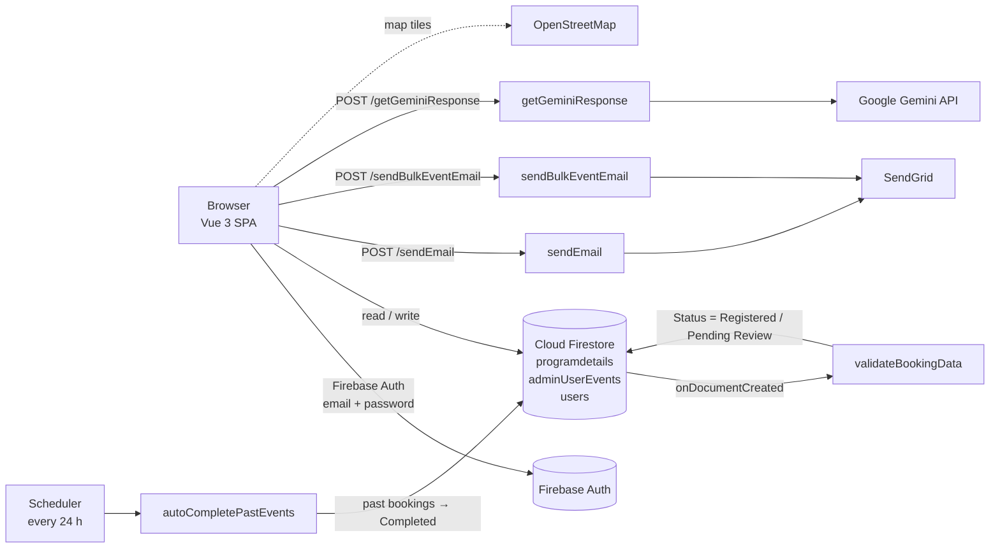

# SportyTribe: find, book and run community sport events

SportyTribe is a single-page web app for community sport events, built with **Vue 3 (Composition API)**,
**Vite** and **Firebase**. Participants can find events on a map near their location, book or cancel
them from a calendar, and rate and review them. Admins get a participant table with CSV/PDF export,
live charts, and a one-click event cancellation that emails every registered participant. I built the
whole thing on my own: the frontend, the Firestore data model, and four **Cloud Functions** for email
(SendGrid), booking validation, a daily scheduled job and a **Gemini** chat assistant. The API keys stay
on the server.

## At a glance

| What | Details |
| --- | --- |
| Pages | **14 views**, 15 routes (Vue Router, history mode), plus a shared header and a floating chat widget |
| Event discovery | Leaflet + OpenStreetMap map centred on the browser's geolocation, with a 25 / 50 / 100 / 200 km / all radius filter (Haversine distance) and an event-detail modal showing ratings and reviews |
| Booking | FullCalendar month view built from Firestore. Signed-in users book or cancel by clicking an event; **only one booking per user per date** |
| Ratings and reviews | PrimeVue DataTable of events with star ratings (live average) and free-text reviews saved to Firestore |
| Admin tools | Searchable, paginated participant table; **CSV and PDF export** (jsPDF + autoTable); Chart.js bar chart (registrations by location) and pie chart (by status) |
| Event cancellation | Admin picks an event, every `Registered` participant gets a personalised SendGrid email, then their bookings are set to `Cancelled` |
| Serverless backend | **4 Cloud Functions**: 2 HTTPS email endpoints, 1 Firestore `onCreate` validation trigger, 1 job that runs every 24 hours |
| AI assistant | "SportyBot" chat widget; questions go to a Cloud Function that calls Gemini 2.0 Flash, so the key never reaches the browser |
| Accessibility | Skip-to-content link, landmark roles, `aria-live` status messages, labelled form controls, visually hidden labels on rating/review inputs, screen-reader announcement of how many events are within the map radius |

## Architecture



**Firestore collections**

| Collection | Holds | Written by |
| --- | --- | --- |
| `programdetails` | Events: name, date, location, `lat`/`lng`, `ratings[]`, `reviews[]` | Seed script, rating/review UI |
| `adminUserEvents` | Bookings: name, gender, email, `Event`, `date`, `Location`, `Status` | Calendar booking, admin cancel, Cloud Functions |
| `users` | Profile per Auth UID: email, gender, `role` (`user` or `admin`) | Registration forms |

## Repository layout

| Path | What's inside |
| --- | --- |
| [`src/views/`](src/views/) | The 14 pages: home, programs, calendar, nearby events, resources, contact, user and admin sign-in/registration, and the admin dashboard, participant list and event-cancel pages |
| [`src/components/`](src/components/) | [`headernav.vue`](src/components/headernav.vue) (shows admin links when the role is admin) and [`SportyBot.vue`](src/components/SportyBot.vue) (chat widget) |
| [`src/router/index.js`](src/router/index.js) | Route table and page titles |
| [`src/firebase/init.js`](src/firebase/init.js) | Firebase app, Auth and Firestore setup (API key from `VITE_FIREBASE_API_KEY`) |
| [`src/assets/json/`](src/assets/json/) | Seed data: 28 events, 50 generated sample bookings, 3 fitness resource articles |
| [`functions/index.js`](functions/index.js) | All Cloud Functions |
| [`programdetails.mjs`](programdetails.mjs) | One-off script that uploads the event seed data to Firestore |
| [`firebase.json`](firebase.json), [`firestore.rules`](firestore.rules), [`firestore.indexes.json`](firestore.indexes.json) | Firebase project config (Firestore in `australia-southeast1`) and the local emulator suite |

## Engineering decisions

1. **Secrets live in Cloud Functions, not the browser.** The SendGrid and Gemini keys are declared with
   `defineSecret()` and only read inside the functions. The browser calls the functions and never sees a key.
2. **CORS allow-list on the email endpoints.** `sendEmail` and `sendBulkEventEmail` only return
   `Access-Control-Allow-Origin` for localhost and the deployed site, handle `OPTIONS` preflight, and reject
   anything that isn't a `POST` with `405`.
3. **Validation on the server as well as in the form.** The forms check password strength (length, upper and
   lower case, digit, symbol), email format and required fields. A Firestore trigger then checks every new
   booking again (name length, allowed gender values, email, event and location present). It stamps the
   booking `Registered` or `Pending Review` and records `_validationErrors` and a server timestamp.
4. **Booking status updates itself.** A scheduled function marks every past `Registered` booking as
   `Completed`, applying all the changes in one Firestore batch write.
5. **One booking per user per date.** Before it opens the booking form, the calendar runs a query on
   `email` + `date`. If the user already has a booking that day, they get the cancel form instead.
6. **Role-aware UI.** At registration, a profile is saved to `users/{uid}` with a `role`. The header reads it
   in `onAuthStateChanged` and shows the admin pages only to admins.
7. **Exports in the browser.** CSV is built as a `Blob`, and PDFs come from jsPDF + autoTable, so exports
   need no server.

## Next improvements

- Per-collection Firestore security rules (owner-only writes to `users/{uid}`, users creating only their own
  bookings, admin-only reads of `adminUserEvents`).
- Move admin roles to Firebase custom claims and add `router.beforeEach` route guards.
- Verify a Firebase ID token on the email endpoints and fix the contact form's recipient on the server.
- Compress the hero images and code-split the admin pages to cut the bundle size.

## Tech stack

Vue 3, Vite, Vue Router, PrimeVue (Aura theme), Bootstrap 5, Leaflet + OpenStreetMap, FullCalendar,
Chart.js / vue-chartjs, jsPDF + jspdf-autotable, date-fns, Lucide and Iconify icons, Firebase Authentication,
Cloud Firestore, Cloud Functions for Firebase (Node.js 20), Cloud Scheduler, SendGrid, Google Gemini API,
Cloudflare Pages (frontend hosting).

## Run it yourself

Requires Node.js 20.19+ or 22.12+ and a Firebase project of your own.

```bash
# Frontend
npm ci
echo "VITE_FIREBASE_API_KEY=<your web API key>" > .env.local   # other config values are in src/firebase/init.js
npm run dev            # http://localhost:5173
npm run build          # production build in dist/

# Seed the events collection (once)
node programdetails.mjs

# Cloud Functions (needs the Firebase CLI and the Blaze plan)
cd functions && npm ci
firebase functions:secrets:set SENDGRID_API_KEY
firebase functions:secrets:set GEMINI_API_KEY
firebase deploy --only functions
# or run locally: firebase emulators:start
```

If you deploy to your own project, change the project ID in [`.firebaserc`](.firebaserc) and
[`src/firebase/init.js`](src/firebase/init.js), the function URLs in the views, and the CORS origins in
[`functions/index.js`](functions/index.js).

## Acknowledgements

Map data © [OpenStreetMap](https://www.openstreetmap.org/copyright) contributors. Email is sent through
SendGrid and the chat assistant uses Google Gemini. The sample bookings in
[`src/assets/json/adminUserEvents.json`](src/assets/json/adminUserEvents.json) are generated test data, not
real people.
